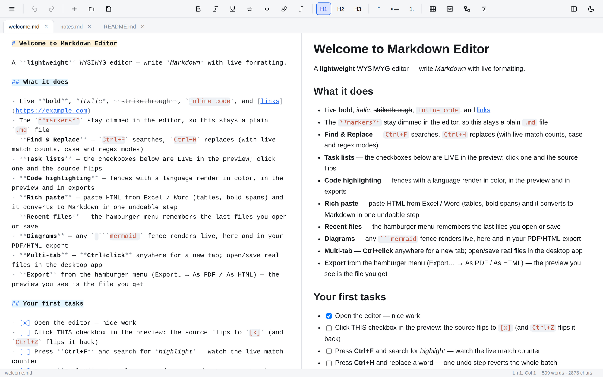
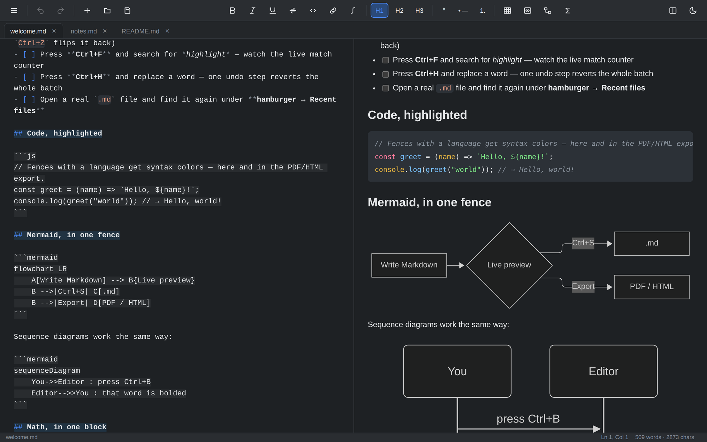
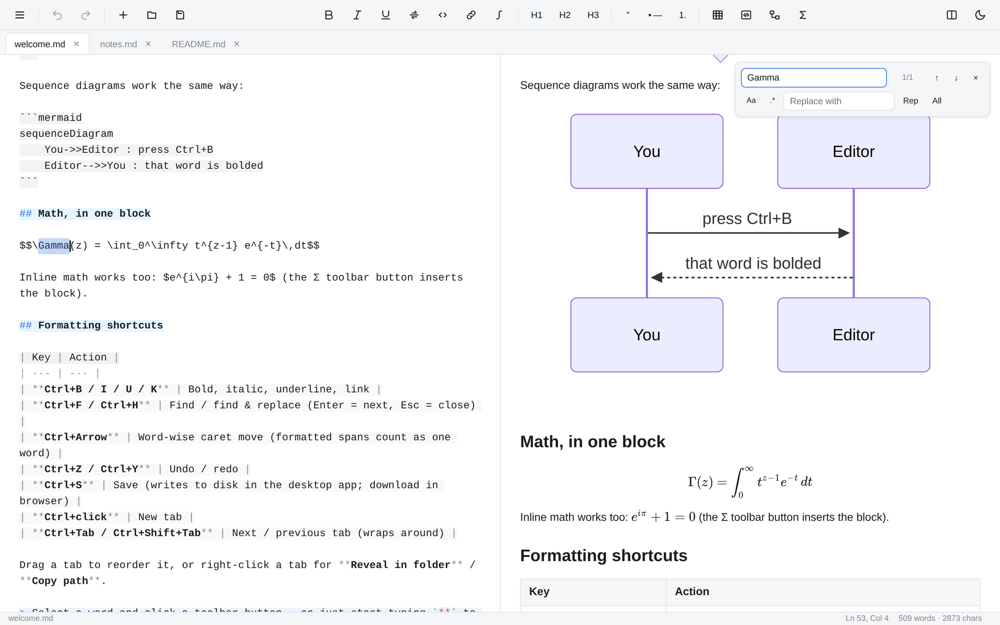
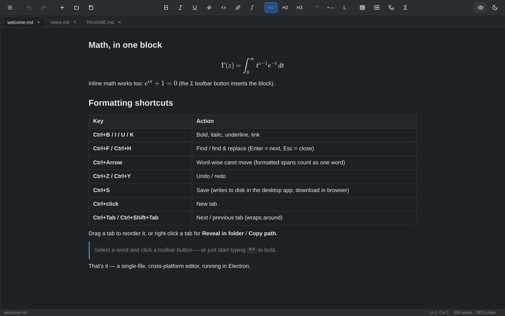

<p align="center">
  
</p>

<h1 align="center">Markdown Editor</h1>

<p align="center">
  <strong>Write Markdown. See it live. Keep plain files.</strong><br>
  A fast, lightweight, cross-platform desktop Markdown editor with a WYSIWYG feel.
</p>

<p align="center">
  <a href="https://github.com/MagFlux/MarkdownEditor/releases/latest"></a>
  <a href="https://github.com/MagFlux/MarkdownEditor/actions/workflows/ci.yml"></a>
  <a href="LICENSE.md"></a>
  <a href="#install"></a>
  <a href="https://www.electronjs.org/"></a>
</p>

<p align="center">
  <a href="#features">Features</a> ·
  <a href="#screenshots">Screenshots</a> ·
  <a href="#install">Install</a> ·
  <a href="#build-from-source">Build from source</a> ·
  <a href="#shortcuts">Shortcuts</a> ·
  <a href="#testing">Testing</a> ·
  <a href="AGENTS.md">Engineering guide</a>
</p>

<p align="center">
  <a href="docs/screenshots/editor-light.png">
    
  </a>
</p>

<p align="center"><sub><b>Split view</b> — the Markdown source stays readable and highlighted; the preview updates as you type.</sub></p>

**Markdown Editor** gives you the immediacy of a WYSIWYG editor without giving up plain Markdown. Formatting markers are dimmed in the source, the rendered result is always one glance away, and every document is still a normal `.md` file you can edit anywhere.

Built with **Electron** + **Vite** — no frontend framework, one DOM, one source of truth. [AGENTS.md](AGENTS.md) is the exhaustive engineering reference (invariants, test history, per-file contracts); this README is the readable overview.

---

## Features

- **WYSIWYG-style editing** — Split / Edit / Preview modes, a live formatting overlay, inline bold / italic / underline / strikethrough / code / links, and insert-only block tools for headings, quotes, lists, fences, tables, Mermaid and math.
- **Smart keyboard** — Enter continues list items with indentation, Tab / Shift+Tab indent/outdent, `Ctrl+←/→` moves by Markdown-aware words, and toolbar state follows the caret instantly.
- **Multi-tab workspace** — drag tabs to reorder, `Ctrl+Tab` / `Ctrl+Shift+Tab` to cycle, right-click for **Reveal in folder** / **Copy path**, plus per-tab scroll memory within a run and session restore across restarts.
- **Live preview** — GFM tables and task lists, syntax-highlighted code (16 grammars), Mermaid flowcharts and sequence diagrams, and KaTeX display/inline math — all rendered as you type.
- **Find & Replace** — floating, non-modal bar (`Ctrl+F` / `Ctrl+H`) with live counts, auto-selected matches, case/regex toggles, `$1` substitutions, wrap-around navigation, and one-undo replace/replace-all. In split view the preview follows the revealed match.
- **Plain files, no lock-in** — in-app save/open picker with overwrite confirmation, recent files, drag-and-drop, and an unsaved-changes guard on tab/window close. Browser fallback included.
- **Export** — self-contained HTML with embedded KaTeX fonts, or a multi-page A4 PDF. What you see in the preview is what lands in the file.
- **Comfort features** — persisted light/dark theme, content-anchored split-view scroll sync, scroll preservation across tab/mode/theme/dialog changes, themed scrollbars, rich HTML paste from Excel/Word, and files that open with the caret at the top.
- **Cross-platform** — Windows, macOS (Apple Silicon), and Linux installers plus portable builds.

---

## Screenshots

<table>
  <tr>
    <td width="50%" valign="top">
      <a href="docs/screenshots/editor-dark-diagrams.png">
        
      </a><br>
      <sub><b>Diagrams</b> — Mermaid fences render live beside the source.</sub>
    </td>
    <td width="50%" valign="top">
      <a href="docs/screenshots/find-and-replace.png">
        
      </a><br>
      <sub><b>Find &amp; Replace</b> — live count, regex, one-undo replace-all.</sub>
    </td>
  </tr>
</table>

<p align="center">
  <a href="docs/screenshots/editor-dark-preview.png">
    
  </a>
</p>

<p align="center"><sub><b>Preview-only, dark theme</b> — KaTeX math and GFM tables, typeset exactly as exported.</sub></p>

*Click any screenshot to open it full size.*

---

## Install

Grab the latest release for your platform:

| Platform | Packages |
|---|---|
| **Windows** | NSIS `.exe` installer, WiX `.msi`, portable `.exe` |
| **macOS** (Apple Silicon) | `.dmg`, portable `.zip` |
| **Linux** | `.AppImage`, `.deb`, portable `.tar.gz` |

**[Download the latest release →](https://github.com/MagFlux/MarkdownEditor/releases/latest)**

Installers are unsigned by default, so Windows SmartScreen and macOS Gatekeeper may warn on first launch. Prefer to build it yourself? See below.

---

## Build from source

Requires **Node 20+**. `npm install` also downloads the Electron runtime.

```bash
npm install

# Native dev window (Vite + Electron)
npm run electron:dev

# Browser-only UI (same editor, no shell)
npm run dev

# Package installers for this platform → release/
npm run electron:build
```

`npm run electron:start` builds `dist/` and runs the packaged-style app locally. Always package through `npm run electron:build`: electron-builder packs `dist/` + `electron/` and builds nothing itself, so a bare `npx electron-builder` produces a dist-less app that fails at boot. The `beforePack` hook (`scripts/before-pack.cjs`) now hard-fails that case.

Artifacts land in `release/`: Windows NSIS + MSI + portable `.exe`; macOS `.dmg` + `.zip`; Linux AppImage + `.deb` + `.tar.gz`. Icons live in `build/` (`icon.svg` is the source art); regenerate the derived PNG/ICO/ICNS set after changing it. Windows Explorer may cache the old `.exe` icon — `ie4uinit.exe -show` refreshes it.

---

## Shortcuts

| Action | Shortcut |
|---|---|
| Bold / Italic / Underline / Link | `Ctrl+B` / `Ctrl+I` / `Ctrl+U` / `Ctrl+K` |
| Find / Replace | `Ctrl+F` / `Ctrl+H` (next `Enter`/`F3`, prev `Shift+Enter`/`Shift+F3`, close `Esc`; disabled in Preview-only mode) |
| Save / New tab / Close tab | `Ctrl+S` / `Ctrl+T` / `Ctrl+W` |
| Next / previous tab | `Ctrl+Tab` / `Ctrl+Shift+Tab` (wrap-around) |
| Undo / Redo | `Ctrl+Z` / `Ctrl+Shift+Z` or `Ctrl+Y` |
| Word-wise caret move / selection | `Ctrl+←` / `Ctrl+→` (+ `Shift`; formatted spans count as one word) |
| Indent / Outdent | `Tab` / `Shift+Tab` |
| Open link at caret | `Ctrl+Click` |
| New tab (anywhere) | `Ctrl+Click` the window (a `Ctrl+Click` on a tab just activates it) |

---

## How it works (short)

- An invisible `<textarea>` shares exact font metrics with a pre-rendered highlight `<div>`; the caret never drifts.
- **Round-trip invariant**: stripping every `<span>` from the overlay HTML reproduces the source character-for-character — that is what keeps the caret aligned (`npm test` enforces it).
- The DOM is the single source of truth; overlay and preview both re-render from it, so undo/redo is a simple stack of snapshots.
- All shell/export/diagram/math libraries are **statically imported**, keeping the production bundle a single `dist/assets/index-*.js`. Every shell call is guarded by `isTauri()`, which detects `__TAURI_INTERNALS__` installed by `electron/preload.cjs`; `src/shellapi.js` is the frontend wrapper over the Electron IPC bridge.

---

## Testing

Every guard is a standalone Playwright or Node script and exits non-zero on failure. CI runs the full roster on every PR and release.

```bash
npx playwright install chromium   # one-time
npm test                          # round-trip invariant + math pipeline + packaging guard (Node, instant)
npm run verify                    # UI smoke test (tabs, undo, tables)
```

**Run targeted locally.** Run `npm test` plus only the `verify-*` suites your change touches — the mapping is in [AGENTS.md](AGENTS.md). Save the full local run for release-grade milestones.

<details>
<summary><b>Full test roster</b></summary>

| Script | Cases | Guards |
|---|---|---|
| `npm test` | 36 | round-trip invariant, math pipeline, task mapping, code highlighting, packaging guard |
| `verify` | — | UI smoke test (tabs, undo, tables) |
| `verify-undo` | 11 | undo/redo UI walk |
| `verify-save` | 26 | save / close-guard dialogs, dirty-tab walk order; a newly opened file (and the first-run document) starts with the caret at the beginning |
| `verify-toolbar` | 56 | toolbar active-states track the caret; inline-math guards (code/display/currency precedence) |
| `verify-paste` | 18 | HTML clipboard → Markdown, single undo step |
| `verify-export` | 32 | PDF/HTML export menu + save/cancel paths |
| `verify-math` | 21 | KaTeX preview rendering; self-contained HTML export; PDF raster |
| `verify-scroll` | 5 | split-view scroll-sync accepts a real follow-pane scroll instantly; follow lands on the content-matched block |
| `verify-dialogscroll` | 31 | opening the Save/Open/Export picker never moves the document (toolbar buttons, Ctrl+S/O, cancel keeps focus+position, close doesn't flicker); confirming Open starts the new file with the caret at the beginning |
| `verify-scrollsync` | 17 | block-anchored sync: deep-heading alignment after mermaid/KaTeX regions, per-row table anchors, preview-lead parity, wrap-heavy docs, ratio fallback on desync, end-of-doc convergence (no snap/blend overshoot), elastic follower glide (instant only for tiny deltas), end-region re-correction pans slowly, and the follower never moves again once the glide lands |
| `verify-modescroll` | 8 | mode switch preserves the scroll ratio |
| `verify-modefocus` | 13 | mode click skips its trailing focus only when entering preview |
| `verify-tabclick` | 46 | tab strip: a click anywhere in a tab (padding included) activates it; re-clicking the active tab is a no-op; Ctrl+Tab/Ctrl+Shift+Tab cycle both ways with wrap; real pointer-drag reorder updates model + DOM + persisted session, never activates a non-active source, still works when DOM pointer capture is unavailable (window-level fallback), and can start on the × close button without closing it (an unmoved × click still closes) while removing the custom ghost, source dim and fixed insertion line synchronously on release (own slot marker included) before the immediate reorder; a WSLg mouse-down/pen-motion relay (different pointerId, isPrimary, buttons 0) still drags; the right-click menu names its target, disables items for unsaved files, copies the exact path (with a focus-restoring execCommand fallback), invokes the native reveal IPC, and closes on Escape/outside-click (a modified shortcut also dismisses it) |
| `verify-tabscroll` | 7 | a tab's scroll positions survive switching away and back |
| `verify-themescroll` | 10 | theme switch preserves scroll; scrollbars flip with the theme |
| `verify-mermaidflicker` | 7 | no raw-code flash on prose keystrokes outside a fence |
| `verify-mermaidstyle` | 38 | mermaid stylesheet-failure fallback + label centering |
| `verify-mermaidfade` | 21 | dark-theme gradient outlines off, no drop shadow; both theme palettes prewarmed at load, and edits re-warm the changed diagram — the next theme toggle always restores synchronously |
| `verify-tauri` | 55 | shell-IPC native path (stubs `__TAURI_INTERNALS__`, drives the real wire contract the Electron preload implements); the picker list re-opens at the TOP on every directory entry |
| `verify-caret` | 92 | caret placement after every edit action, never a highlighted selection |
| `verify-find` | 48 | Find & Replace bar: open/close/focus, count, wrap navigation, case/regex toggles, one-undo replace & replace-all, `$1` groups, split-view preview-follow on reveal, highlight line-box height matches the native selection, preview-mode disable |
| `verify-tasks` | 12 | task-list checkboxes render live, click flips the source in ONE undo step, code-fence checkboxes stay inert |
| `verify-recent` | 12 | recent-files menu: record on open/save, dedupe, cap 5, click opens a new tab, stale entries drop |
| `verify-codecolor` | 7 | fenced-code tokens highlight in the preview, unknown/mermaid stay plain, token colors paint |

</details>

---

<details>
<summary><b>Project layout</b></summary>

```text
MarkdownEditor/
├── index.html                  # entry page, loads the Vite bundle
├── vite.config.js              # dev/preview server on 127.0.0.1 (avoids IPv6 localhost mismatch)
├── electron/
│   ├── main.cjs                # Electron main process: BrowserWindow, app:// protocol (serves dist/),
│   │                           # shell-IPC router (fs read/write/list/exists + home + opener incl. reveal-in-folder + events) and
│   │                           # the window-close intercept → close-requested walk
│   └── preload.cjs             # renderer bridge: installs window.__TAURI_INTERNALS__ translating the
│                               # plugin:* command contract onto Electron IPC (see src/shellapi.js)
├── scripts/
│   └── electron-dev.cjs        # `npm run electron:dev` — starts vite, waits for the port, launches Electron
├── build/                      # packaging icons (electron-builder buildResources): icon.png/.ico/.icns + sizes
├── docs/screenshots/           # README screenshots (light/dark, diagrams, Find & Replace)
├── electron-builder.yml        # packaging config: NSIS+MSI+portable (win), dmg+zip (mac), AppImage+deb+tar.gz (linux)
├── src/
│   ├── main.js                 # bootstrap: createApp(#app) + sample content (feature-tour welcome doc; + katex css/asset imports)
│   ├── markdown.js             # app shell: createApp() — tabs, undo, keybinds, save/open, DnD, modals, recent-files menu; static shell imports
│   ├── shellapi.js             # shell-IPC layer (Electron): vendored wrappers over __TAURI_INTERNALS__.invoke — fs/path/opener (incl. reveal in folder)/window contract
│   ├── export.js               # static PDF/HTML export pipeline and native/browser save adapters
│   ├── session.js              # versioned localStorage persistence and debounced saves
│   ├── dialogs.js              # centered in-app modals and overwrite confirmation
│   ├── picker.js               # in-app Save/Open filesystem picker (platform-aware path separator)
│   ├── editing.js              # formatting mutations (inline toggles incl. $…$ math) and indentation factory
│   ├── links.js                # link detection and shell/browser opening factory
│   ├── history.js              # undo/redo history factory
│   ├── find.js                 # floating non-modal Find & Replace bar (literal + regex, one-undo replace-all)
│   ├── tasks.js                # GFM task lists: preview checkbox enhancement + ordinal→source mapping
│   ├── tabbar.js               # tab strip: drag-reorder, Ctrl+Tab cycling, right-click menu (Reveal in folder / Copy path)
│   ├── scrollsync.js           # block-anchored split-view scroll sync (marked-lexer anchors + measured overlay geometry)
│   ├── codecolor.js            # fenced-code syntax highlighting (highlight.js core + ~16 grammars)
│   ├── render.js               # overlay-highlight renderer (esc, computeBlocks, lineToHtml, highlightToHtml)
│   ├── mermaid.js              # mermaid SVG rendering + theme-keyed anti-flicker cache (both palettes prewarmed) + stylesheet-failure fallback
│   ├── format.js               # selection + format detect/wrap helpers (lineBounds, wordAt, detectFormat, …)
│   ├── paste.js                # rich-paste HTML→Markdown (mdFromHtml, mdTableFromHtml, …)
│   ├── math.js                 # LaTeX math ($$ block + $ inline, KaTeX): renderMarkdown pipeline + export-CSS builder
│   ├── katexExportAssets.js    # browser-only katex ?raw/?url imports (main.js only) for the HTML math export
│   ├── icons.js                # inline-SVG toolbar icons
│   └── style.css               # all styles, light + dark themes, editor/preview/tab bar
├── .github/workflows/ci.yml    # CI: test suite + 3-OS build (installers + portables) → GitHub Release
├── LICENSE.md / NOTICE.md      # AGPL-3.0 + third-party notices
└── test/                       # one test file per feature regression (see Testing above)
```

Everything cross-file is a **static import**; further splitting is safe as long as the single-bundle invariant holds and no dynamic `import()` is introduced.

</details>

---

## CI / Releases

The pipeline (`.github/workflows/ci.yml`) runs on pull requests and releases only (not every push):

| Event | What runs |
|---|---|
| PR (`opened/synchronize/reopened/ready_for_review`) | the full Playwright `test` job |
| Release created | `validate-tag` → `test` → three parallel build jobs (Windows/macOS/Linux installers + portables) attached to the release |

**Cutting a release:** the git tag is the version — there are no version files to bump. Publish a release tagged `vX.Y.Z` (numeric prerelease suffix `-N`, `N ≤ 65535`; text like `-rc.1` is rejected by the Windows MSI bundler). CI injects the tag into `package.json` and packages with the same `npm run electron:build` you use locally, so the frontend bundle is always included. The `beforePack` guard hard-fails a dist-less package.

**Signing:** with no secrets set, installers are unsigned (Gatekeeper/SmartScreen warn on first run). To sign/notarize, set `CSC_LINK` / `CSC_KEY_PASSWORD` (Windows) and the macOS identity/notary credentials as Actions secrets, then remove the `mac.identity: null` override in `electron-builder.yml`.

---

## Security notes

- The Electron shell exposes a small fixed IPC surface (`shell:invoke` — file read/write/list/exists, home dir, external URL opener, window destroy). The fs surface is unrestricted by design (any path, including hidden dot-folders — matching the previous shell's `fs:scope ["**"]`). Tighten before shipping to third parties.
- The renderer has **no Node access** (`nodeIntegration: false`); the preload only installs the IPC bridge. `contextIsolation` is deliberately OFF so the bridge and its event callbacks live in one realm — the app loads only local content (`app://` in production, the local Vite dev server in dev), and external navigation/window-open is blocked in `electron/main.cjs`.
- The production CSP (served by the `app://` handler) allows `unsafe-inline` styles because the editor and Mermaid inject inline styles; scripts are limited to `'self'`.

<details>
<summary><b>Shell gotchas (do not regress — full detail in AGENTS.md)</b></summary>

- `isTauri()` must detect `__TAURI_INTERNALS__` (installed by `electron/preload.cjs`) or every native branch silently no-ops in the real app.
- All shell/export libraries are **statically imported** — never `await import(...)`; a failed runtime chunk fetch means silent data loss (save becomes a dropped download, the close guard never registers).
- The window-close handler must not self-close or `preventDefault()` unconditionally — cancel → `preventDefault()`, success → do nothing (the wrapper destroys; the main process force-closes). `closeApp()` is the single dirty-tab prompt walk.
- The app decides the display path in `electron/main.cjs`: **native Wayland whenever `WAYLAND_DISPLAY` exists**, but on WSLg Wayland cannot paint a first frame at all, so the window force-shows after 2.5 s and relaunches once on X11 (`--md-x11`) if no frame ever arrived. Electron is **pinned to `^40` (Chromium 144)** on purpose: Chromium 146 introduced the X11/XWayland wheel-delta regression (upstream 496255940) that killed real hardware wheels here; platform overrides are **argv-only** (`npm run electron:start -- --md-x11`).
- On **WSLg** the wheel is rescued at the X layer: `electron/xwheel-daemon` captures XI2 raw notches and `electron/main.cjs` re-injects them as synthetic wheels; `src/wheeloverride.js` drops only the duplicate half when Chromium's own decode also delivers the same notch. The rescue is fully gated — non-X11 launches run stock Electron, and `MD_NATIVE_WHEEL=1` disables the page-side suppression for A/B.
- Diagnostics keybinds: **Ctrl+Shift+D** opens the live wheel-capture panel and **Ctrl+Shift+M** opens the Mermaid diagnostics modal — both for bug reports on hardware-specific issues synthetic tests cannot reach.

</details>

---

## Contributing

Issues and pull requests are welcome. Run the targeted tests for your change, update both docs, and keep the single-bundle invariant intact. See [AGENTS.md](AGENTS.md) for the full engineering guide.

## License

[AGPL-3.0](LICENSE.md) — chosen deliberately: everything shipped (or served) stays open-source. [NOTICE.md](NOTICE.md) lists the bundled dependencies and their licenses (permissive by default; `highlight.js` is BSD-3-Clause, `elkjs` is the one user-approved copyleft exception; Electron is MIT and ships its own Chromium/Node runtime). Adding a dependency? Prefer permissive (MIT/Apache-2.0/BSD), get copyleft user-reviewed, and update `NOTICE.md` in the same change — see [AGENTS.md](AGENTS.md).

## Documentation

`README.md` is the readable overview. [`AGENTS.md`](AGENTS.md) is the source of truth for how to build, test, and run the project, and holds the full invariant rationales, debugging history, and per-file contracts. When you change anything user- or tool-visible, update both in the same change so neither describes the state before your edit.
